# WTW Design Document

Sections are owned by the person named in each heading. The Week 4 architecture/status below describes the current implementation; M2 UI and requirement-map sections retain historical milestone context.

## Data model (Alan)

Postgres (Supabase) is the source of truth. Clients read through RLS; **only our API writes** (service role).
Columns below are the ones the decision engine relies on; Razin's migration is authoritative for the rest.

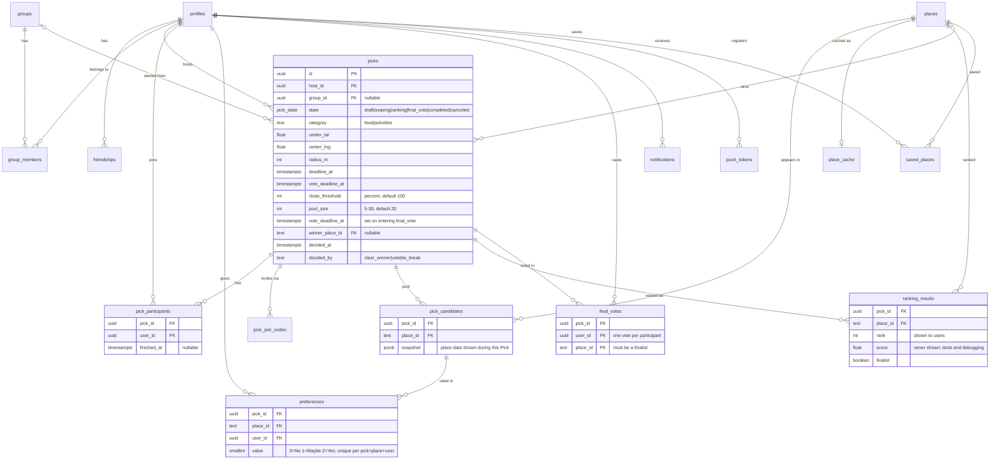

| Table | Purpose |
|---|---|
| `profiles` | One row per account (created on first sign-in). |
| `friendships` | Friend requests, accepted friends, blocks. |
| `groups`, `group_members` | Reusable groups for repeat Picks. |
| `picks` | One decision session: host, category, center + radius, deadline, close threshold, state, and the stored winner (`winner_place_id`, `decided_at`, `decided_by`). |
| `pick_participants` | Who is in a Pick and whether they finished swiping. |
| `pick_join_codes` | 6-character join codes / QR / `wtw://join/CODE` links. |
| `places`, `place_cache` | Normalized places; cache table remains proposed. Google content has field-specific storage restrictions, not a blanket 30-day TTL; see [Phase 1 policy](places-phase1.md). |
| `pick_candidates` | The fixed, shared pool for one Pick (snapshot, so history does not change when a place does). |
| `preferences` | Each participant's private Yes/Maybe/No per candidate. |
| `ranking_results` | Output of the ranking engine for a Pick. |
| `final_votes` | One ballot per participant among the finalists. |
| `notifications`, `push_tokens` | Invitation and Pick-status notifications. |
| `saved_places` | Ideas saved from Discover. |

## Pick state machine (Alan)

Code: `supabase/functions/_shared/domain/pickState.ts` (`canTransition(from, to, actor)`; `dueToClose` for the deadline / close-threshold rule).
The API is the only writer of `picks.state` and rejects every action that does not belong to the current state
(for example a swipe after ranking, or a vote for a non-finalist).

Code: `_shared/api/lifecycle.ts` (create/start/refresh/cancel/read), `closing.ts` (`closePick`),
`voting.ts` (`castVote`, `closeVote`, `closeVoteByDeadline`, `tallyVotes`); SQL in
`supabase/migrations/0003_pick_lifecycle.sql` and `0004_pick_close_and_vote.sql`. Every rule below is
checked twice: in TypeScript, and again inside the RPC under a row lock (the API uses the service role,
which bypasses RLS). Tests: `tests/lifecycle.test.ts`, `closing.test.ts`, `voting.test.ts`, the pgTAP
files in `supabase/tests/`, and the full loop over HTTP in `tests/api/loop.test.mjs`.

**Routes (M3, as coded).** Every route needs a signed-in caller.

| Route | Who | Allowed in | Effect |
|---|---|---|---|
| `POST /picks` | anyone | — | Creates a `draft`; the caller is host and first participant. Body `{ category, center: {lat, lng}, radiusM, poolSize, deadlineAt, closeThreshold }` (pool size 5–30, deadline 5 min–7 days ahead or `null`); 201 `{ pickId, state }`. |
| `POST /picks/join` | anyone | `draft`, `swiping` (or already in) | `{ code }` → `{ pickId }`; see Security & privacy. |
| `GET /picks/:id` | participant | any | The Pick, its candidates in the caller's own deterministic shuffle (`shuffle.ts`), and only the caller's answers. |
| `POST /picks/:id/start` | host | `draft`, ≥ 2 participants | Builds the pool (`PoolBuilder`, `MockProvider` for now; the Google builder exists but isn't wired to Picks yet), freezes it as `pick_candidates`, → `swiping`. |
| `POST /picks/:id/refresh` | host | `draft`, `swiping` | Replaces the pool. Free while nobody has answered; after that it needs `{confirm:true}` and clears every answer. |
| `POST /picks/:id/cancel` | host | any unfinished state | → `canceled`. |
| `POST /picks/:id/swipes` | participant | `swiping` | Saves one answer, then runs the auto-close check. |
| `POST /picks/:id/close` | host | `swiping` | Ranks and decides now, whatever the threshold. Calling it again returns the same result. |
| `POST /picks/:id/vote` | participant | `final_vote` | `{ placeId }` for a finalist; one ballot per person, changeable until the vote closes. |
| `POST /picks/:id/close-vote` | host | `final_vote` | Tallies now with whatever ballots exist. |
| `POST /internal/sweep` | cron (`x-cron-secret`) | `swiping`, `final_vote` | Closes Picks whose `deadline_at` / `vote_deadline_at` passed via `closePick` / `closeVoteByDeadline` (Josh, `0007_deadline_sweep.sql`). |

**Closing swiping (three ways, one function).** `closePick` handles all three: the host's Close,
the check after every swipe, and the deadline sweep. A participant is *done* when they have answered
every candidate. The system closes when `done × 100 ≥ close_threshold × participants`
(integer math), or when `deadline_at` has passed. Closing ranks the pool, stores
`ranking_results`, and goes straight to `completed` (clear winner) or `final_vote`. It is idempotent:
if the Pick already closed, it reports that result. If another swipe lands between reading and
writing (a version conflict), it retries with the fresh answers, up to 3 times. A system close that
keeps losing gives up quietly, and the next swipe or the sweep closes it. A failed auto-close never
turns a saved swipe into an error.

**The final vote.** Finalists are the top 3, plus everyone tied with #1 (or the 1–2 that exist).
Entering `final_vote` sets `picks.vote_deadline_at` = now + 30 min (`VOTE_WINDOW_MS`), separate from
the swipe deadline, which has usually already passed. Two columns, one meaning each: `deadline_at` is
always the swiping deadline (never rewritten) and `vote_deadline_at` is the voting deadline (null
outside a vote). The vote deadline is written once, by the close that leaves `swiping`; re-running a
close cannot move it, because that write only happens from `swiping`. *The 30-minute length is a
placeholder the team hasn't confirmed; the plan doesn't define it.* The vote closes when everyone has voted, the
host calls close-vote, or `vote_deadline_at` passes (the sweep selects
`state = 'final_vote' and vote_deadline_at <= now()` and calls `closeVoteByDeadline`, which rechecks
the deadline itself). Tally: most votes wins; a tie at the top goes to the better rank (higher score →
closer to the center → place id) and is recorded as `decided_by = 'tie_break'`, otherwise `'vote'`.
No ballots at all means every finalist is tied at zero, so #1 wins by `tie_break`.

**Edge cases (locked by tests).**

| Case | Behavior |
|---|---|
| Someone never answers | Their missing answers count as Maybe; they are not "done", so a 100% threshold waits for the host or the deadline. |
| The host leaves | Nothing needs the host after start: the threshold (e.g. 3 of 4 at 75%) or the deadline closes it. |
| Only 2 candidates | A clear winner if ahead by ≥ 10, otherwise a vote between the two. |
| Everyone says No | Every place scores 15, all tie at #1, so all are finalists and the group votes. |
| Refresh after swipes | Needs confirmation; deleting the old pool cascades to every answer. |
| Two people finish at once | Both auto-close checks race; one wins, the other retries or reports the result. |
| A stranger calls Close on a finished Pick | 403 (the host check runs before the already-closed shortcut). |

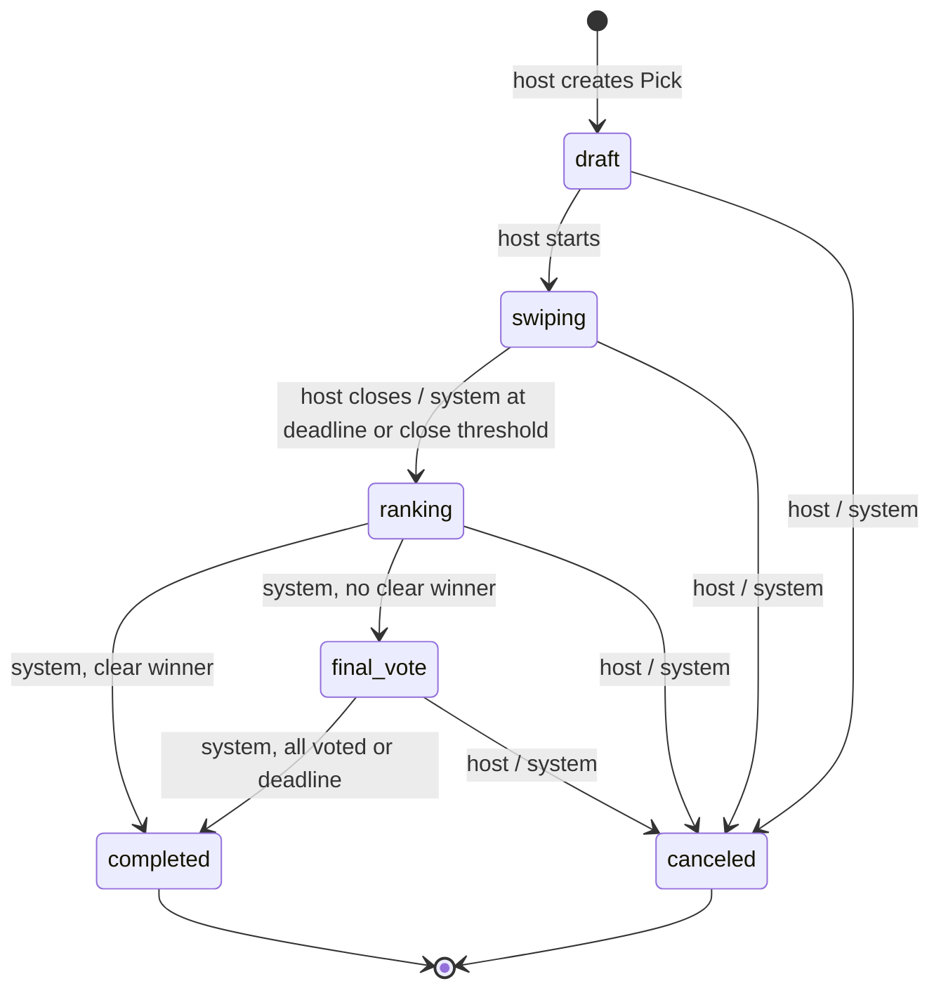

| From → To | Host | Participant | System |
|---|---|---|---|
| draft → swiping | ✅ | ❌ | ❌ |
| swiping → ranking | ✅ (close manually) | ❌ | ✅ (deadline, or X% finished) |
| ranking → completed | ❌ | ❌ | ✅ (clear winner) |
| ranking → final_vote | ❌ | ❌ | ✅ (no clear winner) |
| final_vote → completed | ❌ | ❌ | ✅ (all voted, or deadline) |
| any unfinished → canceled | ✅ | ❌ | ✅ (e.g. stale Pick sweep) |
| completed / canceled → anything | ❌ | ❌ | ❌ |

"System" means our API acting on its own authority: the `pg_cron` deadline sweep, the close-threshold check after a swipe, and the ranking step itself.
Participants never change the state; they only swipe and vote. Refreshing the candidate pool never changes the state (`draft` stays `draft`, `swiping` stays `swiping`).

## Scoring (Alan)

Code: `supabase/functions/_shared/domain/ranking.ts` (`scoreCandidate`, `rankCandidates`, `clearWinner`); tests in `tests/domain/ranking.test.ts`.
This is a transparent formula, not an AI prediction.

**Per candidate**, with `n` participants and answers Yes = 1, Maybe = 0.5, No = 0, **missing = 0.5 (counts as Maybe)**:

| Term | Definition |
|---|---|
| preference | mean of all `n` values |
| consensus | 1 − (population std-dev of the `n` values ÷ 0.5) |
| coverage | people who actually answered ÷ `n` |
| noProportion | number of No answers ÷ `n` |

```
score = 100 × (0.70·preference + 0.20·consensus + 0.10·coverage) − 15·noProportion,   clamped to 0–100
```

**Worked example: broad enthusiasm with one objection vs. lukewarm agreement**

| Answers (n = 4) | preference | consensus | coverage | noProportion | score |
|---|---|---|---|---|---|
| Yes, Yes, Yes, No | 0.75 | 0.134 | 1 | 0.25 | **61.4** |
| Maybe × 4 | 0.50 | 1.000 | 1 | 0 | **65.0** |

Complete moderate agreement edges out a divisive option: one strong "No" costs both consensus and the −15 penalty.
Other reference points (all locked by tests): all Yes = 100, all No = 15, nobody answered = 55, 3 Maybe + 1 missing = 62.5.

**Ordering ties:** score (desc) → distance from the Pick center (asc, haversine) → place id (asc). The result is deterministic.

**Clear winner:** if only one candidate exists, or #1 beats #2 by **≥ 10 points**, #1 wins and the final vote is skipped.
Otherwise the group votes among the top 3 (or the 1–2 that exist). If #1 is tied, it is never a clear winner; everyone tied for #1 is a finalist, even if that makes more than 3.
Float noise is ignored (differences under 1e-9 count as equal), so an exact 10-point gap always counts.

**Final-vote tie-break:** most votes → higher score → closer to the center → place id (`voteWinner`; no ballots by the deadline means #1 wins). When the top vote count was shared, the Pick records `decided_by = 'tie_break'` so the app can say so.

**What users see:** rank only (1st / 2nd / 3rd, or "Clear winner!"). Scores are stored in `ranking_results.score` for tests and debugging and are never sent to the app.

**Input mapping:** `preferences.value` is 0 = No, 1 = Maybe, 2 = Yes; `answerFromDb` converts it before scoring.

**Open question for the team:** the weights (0.70 / 0.20 / 0.10, −15) are a starting hypothesis. M5 user sessions should tell us whether one "No" is penalized enough.

## What changed since M1 (Mike)

| Topic | In M1 | Decision now |
|---|---|---|
| Platform | The proposal said web app; the M1 slides said native apps. | **Native, via Expo + React Native** (one TypeScript codebase for iOS and Android). |
| Group location | A "fair radius for the group" computed from everyone's location. | **The host picks the center and radius** when creating the Pick (`picks.center_lat`, `center_lng`, `radius_m`). |
| Guests | Guests could take part. | **An account is required** to join a Pick. |
| Score | Users see a WTW Match Score. | **Users see rank only** (1st / 2nd / 3rd, or "Clear winner!"). Scores stay server-side; see [Scoring](#scoring-alan). |

## Updated for M3: what changed (Mike)

- **The whole loop has screens**: Create → Lobby (code + QR + Share) → Swipe → Waiting → Results → Vote → Winner, plus a canceled / offline / not-found view. Every screen follows the Pick's state by itself (see [UI flow](#ui-flow-mike)).
- **Live progress without leaking answers**: the app subscribes to Supabase Realtime on `picks` and `pick_participants` only. `pick_participants.finished_at` is kept current by a trigger (`0005_live_progress.sql`), so the socket carries "who's done", never answers. If the channel fails, the app polls `GET /picks/:id/progress` every 5 s. `preferences`, `final_votes` and `ranking_results` are **not** in the publication.
- **Per-person deck**: Swipe reads `GET /picks/:id` (Alan), which returns the candidates in my own shuffled order plus my answers, instead of reading `pick_candidates` in place-id order.
- **Rank stays rank-only**: Results shows 1st / 2nd / 3rd and "Clear winner!"; the vote shows finalists by rank; the API and reads never carry scores.
- **Look**: the live-demo styling (dark, flame gradient, Poppins, Tinder-style deck, confetti reveal) is now the app's look; shared pieces live in `src/components` (`PickParts`, `ResultCards`, `HostMenu`).
- **Mock mode plays the whole loop**: Ava, Ben and Cam join, swipe and vote on timers, using the shared ranking and vote rules, so the demo runs without a network (`EXPO_PUBLIC_USE_MOCK=1`).

## UI flow (Mike)

Every Pick screen calls `usePickLive` (state + progress) and `usePickRoute` (which screen belongs to the state). Opening a Pick from anywhere goes to `/pick/[id]`, which forwards to the current step, so a late arrival lands in the right place.

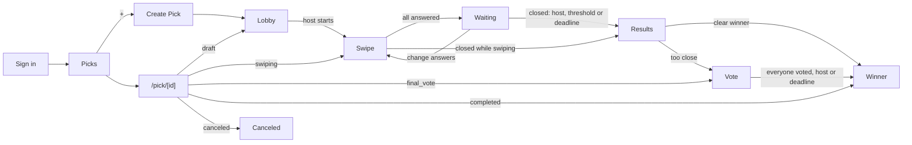

| Pick state | Screen(s) | What it shows |
|---|---|---|
| `draft` | Lobby | Who's in (live), join code + QR + Share, settings (radius, pool, deadline, close rule). Host: Start (needs 2 people), Cancel. |
| `swiping` | Swipe, then Waiting | Swipe: my shuffled deck, resume at first unanswered, Back to change, details sheet, "X of N friends done", deadline countdown; host menu (Close now, Get new places with a reset warning, Cancel). Waiting: "3 of 5 finished swiping", avatars with checks (never answers), countdown, host Close now / Cancel, Change my answers. |
| `ranking` | Results | "Counting everyone's swipes…" |
| `final_vote` | Results → Vote | Results: "Too close to call", finalists by rank. Vote: tap a finalist (radio group), change until it closes, "2 of 4 voted"; host Close the vote. Late arrivals go straight to Vote. |
| `completed` | Results → Winner | Results: "Clear winner!" or "Decided!", 1st/2nd/3rd (rank only). Winner: the place, how it was decided (clear winner / vote / tie-break), Directions (Apple Maps on iOS, Google Maps elsewhere), "Saved to your history". |
| `canceled` | `/pick/[id]` | "This Pick was canceled", Start a new Pick. |
| any, offline | same screen | Last good data stays, a banner says we're retrying (polling every 5 s), Try again. Before anything loaded: "You're offline" with Try again. |

**Accessibility.** Every tappable is ≥ 44 pt (`MIN_TARGET`). Yes / Maybe / No buttons are labelled with the place ("Yes to Kung Fu Tea"); the vote list is a radio group whose items say rank, name and "your vote"; progress counts are a polite live region; avatars announce "Ava, done". Text follows the system font scale (no fixed-height text boxes), long names wrap to two lines instead of being cut, and inputs on Create Pick stay above the keyboard (`KeyboardAvoidingView` in `Screen`).

Screens (mock mode, 375 × 812 viewport):

| Picks | Lobby | Swipe | Waiting |
|---|---|---|---|
| 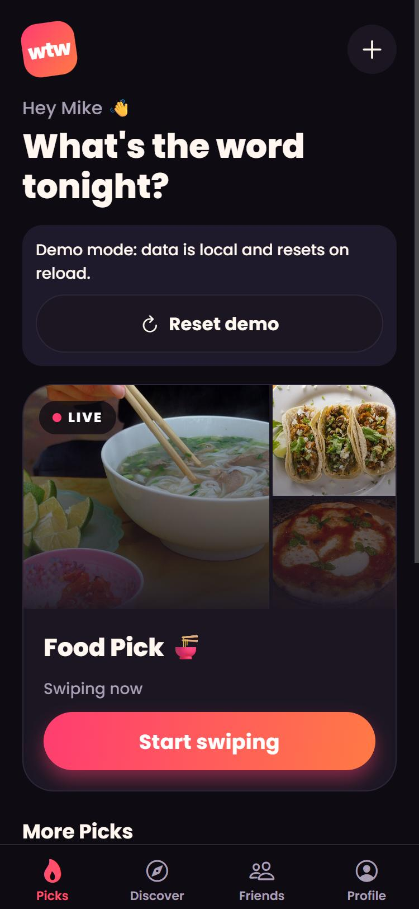 | 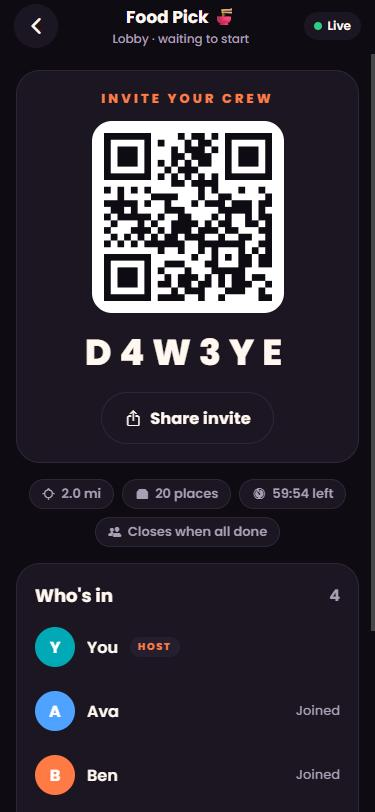 | 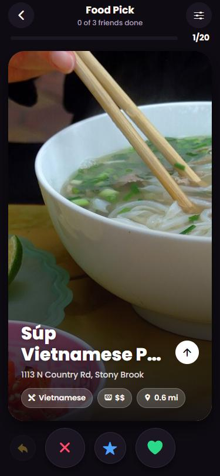 | 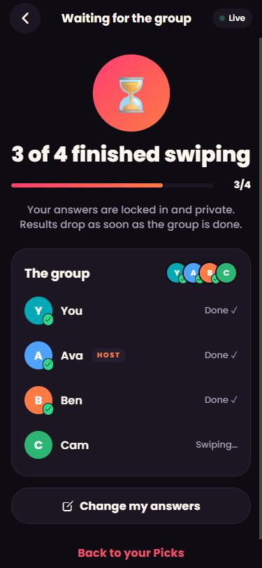 |

| Results | Vote | Winner |
|---|---|---|
| 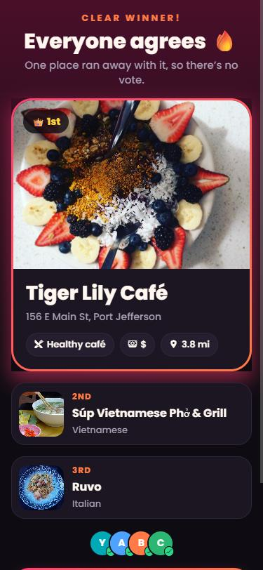 | 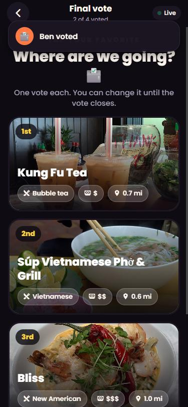 | 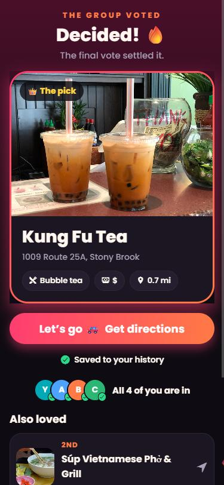 |

## Requirement → component map (Mike)

Status as of M3 (Oct 21). "Screen done" means the app side is built and runs end to end in mock mode; the matching API route's PR is listed where it isn't merged yet.

| FR | Requirement | Screen | API route | Table(s) | Owner | Status |
|---|---|---|---|---|---|---|
| FR-01 | Create an account, sign in, sign out, and maintain a profile. | Sign in; Profile tab (sign out) | None (Supabase Auth) | `profiles` | Razin (auth), Mike (screens) | Sign-in done; profile editing: Razin |
| FR-02 | Complete and later edit a short preference profile. | Onboarding (survey + permission explainers); Profile → Edit preferences | `GET /me`, `POST /me/preferences` | `profiles.discover_preferences` (0011) | Mike | **Done** (M4) |
| FR-03 | Send, accept, remove, and block friend relationships. | Friends tab (placeholder) | planned | `friendships` | Razin | M4 |
| FR-04 | Create, name, and manage a reusable group. | planned | planned | `groups`, `group_members` | Razin | M4 |
| FR-05 | Create a Pick for selected friends or a saved group. | Create Pick → Lobby | `POST /picks` (PR #12) | `picks`, `pick_participants` | Alan, Mike (screens) | **Done** by join code; friends/groups M4 |
| FR-06 | Select Food or Activities and optionally refine location, radius, price, and open status. | Create Pick (map pin, search, radius, pool, deadline, close rule) | `POST /picks` | `picks` | Josh, Mike (screen) | **Done**; price/open filters M4 |
| FR-07 | Retrieve and normalize a bounded nearby candidate pool. | Lobby Start; host "Get new places" | `POST /picks/:id/start`, `/refresh` (PR #12) | `places`, `place_cache`, `pick_candidates` | Josh, Alan | API in review |
| FR-08 | Join an authorized Pick through the app or invitation link. | Lobby shows code + QR + Share (`wtw://join/CODE`) | `POST /picks/join` (Razin) | `pick_join_codes`, `pick_participants` | Razin, Mike (lobby) | **Done**: code, QR/link (`app/join/[code].tsx`), Picks-tab "Join with code" |
| FR-09 | Record exactly one Yes, Maybe, or No response per candidate and revise it before closure. | Swipe (buttons, gesture, Back, Change my answers) | `POST /picks/:id/swipes` | `preferences` | Alan, Mike (screen) | **Done** |
| FR-10 | Persist responses and restore progress after refresh or reconnection. | Swipe resumes at my first unanswered card, in my order | `GET /picks/:id` (PR #12) | `preferences` | Mike | **Done** |
| FR-11 | Hide individual responses until aggregation is complete. | Waiting and Vote show counts and checks only | `GET /picks/:id/progress` (counts only); Realtime on `picks`, `pick_participants` only | `pick_participants.finished_at` | Mike, Razin (RLS) | **Done** |
| FR-12 | Close responses after all participants finish or according to a documented timeout rule. | Waiting (countdown, host Close now); everyone moves to Results by themselves | `POST /picks/:id/close` (PR #13); deadline sweep (Josh) | `picks` | Alan, Josh | Screens done; API in review |
| FR-13 | Calculate deterministic group scores and return the top three candidates. | Results (rank only) | close → `ranking_results` | `ranking_results` | Alan | **Done** |
| FR-14 | Provide a plain-language explanation for each top result (rank + reason, no number). | planned | planned | `ranking_results` | Alan | M4 |
| FR-15 | Vote once among the three finalists. | Vote (changeable until close; host Close the vote) | `POST /picks/:id/vote`, `/close-vote` (PR #13) | `final_votes` | Mike (screen), Alan | Screen done; API in review |
| FR-16 | Resolve ties, declare one winner, and save the outcome. | Winner (clear winner / vote / tie-break; Directions; saved) | vote tally (PR #13) | `picks`, `final_votes` | Alan | Screen done; API in review |
| FR-17 | Browse a bounded individual Discover feed and save interests. | Discover tab (placeholder) | planned | `places`, `saved_places` | Josh | M4 |
| FR-18 | View completed Pick history for groups they belong to. | Picks tab "History" (decided + canceled) | RLS read of my Picks | `picks` | Razin, Mike | **Done** for my Picks; groups M4 |

## Architecture (Josh)

```mermaid
flowchart TD
    App[Expo React Native frontend] --> Auth[Supabase Auth]
    App -->|snapshot and outcome reads through RLS| DB[(PostgreSQL and RLS)]
    App -->|authenticated writes and Pick metadata reads| API[Supabase Hono Edge Function: api]
    API -->|service-role transactional RPCs| DB
    API --> Domain[Canonical lifecycle, closing and voting]
    API -->|start and refresh| Pool[PoolBuilder with direct MockProvider]
    Pool --> Mock[Owned placeholder fixtures]
    Configured[Configured provider and cache infrastructure] -.->|lifecycle wiring blocked| Pool
    Configured --> Google[Google Places adapter]
    API -->|completed or final_vote reads| Hours[Provenance-aware hours refresher]
    Hours -->|explicit Google provenance only| Google
    Cron[pg_cron every minute] --> Net[pg_net]
    Net -->|POST /internal/sweep with x-cron-secret| API
    CI[GitHub Actions validation and local DB/API tests] -->|successful main push only| CD[wtw-dev migration then api deployment]
    CD --> DB
    CD --> API
    DB -.-> RT[Realtime: planned, not implemented]
    RT -.-> App
```

### Implementation and verification status

| Status | Current evidence / boundary |
| --- | --- |
| **IMPLEMENTED** | Lifecycle create/start/refresh/cancel/read, canonical close/vote paths, deadline sweep, read-time opening-hours integration, provider infrastructure, and main-to-wtw-dev CD workflow. |
| **CI VERIFIED** | PR `CI / validate` and `CI / Local database and API` pass. Validation includes lint, types, Jest, Android bundle, Deno checks/route tests; integration runs local migrations/seed, pgTAP/RLS and HTTP/database tests. PR deployment correctly skips. Hours integration is covered by CI. |
| **HOSTED VERIFIED** | No hosted CD, cron delivery, or real backend Google request has been verified for this work. Green CI tests local services/mocks, not hosted wtw-dev behavior. |
| **BLOCKED/PLANNED** | Google lifecycle persistence/display hydration and durable Places cache await a safe data contract. Realtime subscriptions are planned and not operational. |

Clients use Supabase Auth and RLS-filtered reads. Application writes go through the
single `api` Edge Function. Alan's canonical `closePick` handles host/system closure;
auto-close checks run after swipes, and the deadline sweep delegates to the same
closers. Ranking decisions, voting, and winner selection remain canonical domain
logic backed by transactional RPCs.

`pg_cron`/`pg_net` scheduling is implemented in migration `0005`. The internal sweep
uses `deadline_at` for swiping and `vote_deadline_at` for final votes, authenticated
by a separate server secret rather than a user token. Hosted Edge secret/Vault
configuration and delivery verification remain required. See
[cron configuration](api-integration.md#cron-and-wtw-dev-configuration).

Results/reveal candidate reads retain persisted identities/display snapshots and
request additional metadata from the existing authenticated `GET /picks/:id`.
After membership validation, completed/final-vote reads call `refreshOpenHours`.
Fresh owned mock hours are evaluated; stale/missing hours remain unknown. Explicit
Google provenance permits request-time hours lookup without persistence. Failures
never replace candidates or change ranks, winners, votes, or state. The client adds
optional `openNow`/`closesAt`; this does not add hours labels to the screen layout.

### Real versus mock

| Path | Implemented behavior | Runtime / verification limit |
| --- | --- | --- |
| Lifecycle mock | `api/index.ts` directly constructs `createPoolBuilder(new MockProvider())`; start/refresh persist owned candidate snapshots. | Current active lifecycle provider. Bundled placeholders differ from the SBU database demo seed; no hosted lifecycle proof is claimed. |
| Google provider | Search normalization, request timeouts, hours details, provenance and cache safeguards exist. | Unit/CI tested with synthetic responses; no verified real backend Google request. |
| Google → mock fallback | Configured pool tries mock on Google failure, timeout or unusable response; fallback does not poison Google cache. | Tested infrastructure, not connected to lifecycle; geographically limited fixtures can also yield no candidates. |
| `PLACES_PROVIDER` | Configured builder reads `google`/`mock` on each build, defaults to mock, rejects invalid configuration. | Lifecycle bypasses that builder. An env change alone cannot enable Google discovery. |
| Cache | Bounded in-memory mock cache and Google-ID-only entries; no durable Places cache adapter/table. | Configured cache is not injected into current lifecycle; Google IDs do not substitute for fresh display content. |
| Whole-app mock | `EXPO_PUBLIC_USE_MOCK` selects frontend simulation. | Separate from server provider selection; not evidence of backend integration. |

Google lifecycle integration is blocked at persistence, not by a missing adapter.
Start/refresh currently store full candidates in `places.raw` and Pick snapshots;
closing reads frozen candidate coordinates to calculate distance tie-breaks. Our
Google candidates are marked request-only. The existing snapshot guard is not yet
wired into that boundary. ID-only storage plus display hydration would still need
a permitted stable ranking input. Computing distance locally does not establish
permission to retain that derived value. Do not weaken the guard or alter Alan's
ranking to bypass this unresolved contract. See [Places details](places-phase1.md).

The legacy `/rank` route still exists and is used by the current UI when a host
opens results while the Pick remains swiping. It is not the canonical `/close`
path; the earlier integration review identified its missing final-vote deadline.
Coordinate retirement/delegation with Alan and client migration with Mike. Neither
green sweep tests nor this documentation update resolves that separate path.

### CI/CD and synchronization

The CD job depends on both CI jobs, runs only for pushes to main, checks out the
validated commit, and serializes wtw-dev deployments without canceling active work.
A current-main check skips superseded queued commits. It links the hosted project,
applies pending migrations, then deploys `api`; it never resets/seeds hosted data
or configures application secrets. Function failure leaves applied migrations in
place; use compatible migrations and forward-fix recovery. Hosted execution is
not yet tested. See [deployment setup](api-integration.md#main-to-wtw-dev-deployment).

Realtime is not implemented. The current results screen loads/reloads state through
reads rather than subscriptions. Future subscription scope and ownership must be
agreed without exposing private answers or ranking scores.

## Stack + why (Josh)

| Technology | Why |
|---|---|
| Expo / React Native | One mobile codebase supports iOS and Android with quick device iteration. |
| TypeScript | Shared types connect the app, API and pure decision engine. |
| Supabase Auth | Managed identity verifies users without a custom password system. |
| Supabase Postgres + RLS | Relational constraints and row policies protect shared Pick data. |
| Supabase Realtime | Planned only; current clients use explicit reads/reloads. |
| Supabase Edge Functions | A server runtime keeps credentials and privileged operations off phones. |
| Hono | A small router gives the single API explicit routes and error handling. |
| Our TypeScript API | One write boundary enforces authorization, state and ranking rules. |
| PlaceProvider / Google Places abstraction | Stable normalized candidates let mock data become live discovery later. |
| Jest | Repeatable tests exercise shared logic without a phone or database. |
| GitHub Actions | PR/main CI validates code, bundle, local database/API; successful main runs are configured to deploy to wtw-dev. Hosted CD is unverified. |
## Security & privacy (Razin)

Code: `supabase/migrations/0001_init.sql` (RLS, grants), `0002`–`0004` (server-only RPCs), `0006_join_codes.sql` (join codes, `pick_join`, `ranking_results` timing). Tests: `supabase/tests/rls_test.sql`, `join_and_security_test.sql` (`supabase db reset && supabase test db`), and the `POST /picks/join` cases in `supabase/functions/api/app_test.ts`.

**Roles.** `anon` is the app before sign-in. `authenticated` is a signed-in user; RLS decides which rows they see, so the table splits it into a *participant* of a Pick and a *stranger* (signed in, not in that Pick, even if they know its id). `service_role` is the `api` Edge Function only; its key is a server secret and it bypasses RLS, so every API write rechecks the caller (from their verified token), the Pick's state and its version inside one locked transaction.

| Role | Table | Read | Write | How enforced |
|---|---|---|---|---|
| `anon` | every table | ✗ | ✗ | No grants at all (`revoke all`); default privileges revoked so new tables don't leak. |
| `anon` | `pick_join`, every RPC | — | ✗ execute | `revoke execute … from public, anon, authenticated`. |
| participant | `picks` | ✓ own Picks | ✗ | RLS `private.is_pick_participant(id)`; `select` grant only. |
| participant | `pick_participants` | ✓ everyone in my Picks | ✗ (join via API) | RLS `is_pick_participant(pick_id)`; no insert grant. |
| participant | `pick_candidates`, `places` | ✓ my Picks' pool | ✗ | RLS `is_pick_participant` / `private.can_see_place`. |
| participant | `profiles` | ✓ me + people I share a Pick with | ✗ (`PATCH /me` planned) | RLS `id = auth.uid() or private.shares_pick_with(id)`. Email stays in Supabase Auth. |
| participant | `preferences` | ✓ **only my own** answers | ✗ (swipe via API) | RLS `user_id = auth.uid()`; nobody sees how others swiped. Not in Realtime. |
| participant | `ranking_results` | ✓ rank + finalist, **only after the Pick leaves `swiping`**; never `score` | ✗ | RLS `is_pick_participant and private.pick_has_closed` (0006); column grant excludes `score`, so `select *` fails with 42501. Not in Realtime. |
| participant | `final_votes` | ✓ only my own ballot | ✗ (vote via API) | RLS `user_id = auth.uid()`. Not in Realtime. |
| participant | `pick_join_codes` | ✓ my Picks' codes (to share) | ✗ | RLS `is_pick_participant(pick_id)`; `select` grant only. |
| stranger | all of the above | ✗ 0 rows (even with the Pick id) | ✗ | The same RLS policies; tested table by table in `join_and_security_test.sql`. |
| `authenticated` | `pick_join` and every `heartbeat_*` / `pick_*` RPC | — | ✗ execute | Executable only by `service_role`; calling one directly fails with 42501. |
| `service_role` (API) | every table | ✓ | ✓ via RPCs | Bypasses RLS, so the RPCs recheck membership/host, state and version under `SELECT … FOR UPDATE`; PT400/403/404/409 map to HTTP 400/403/404/409. |
| `service_role` (API) | `pick_join_codes` | ✓ | ✓ via trigger + `pick_join` | Codes are issued by a trigger on every new Pick; `pick_join` is the only way into a Pick. |

**Joining (0006).** Every Pick gets a 6-character code from `ABCDEFGHJKLMNPQRSTUVWXYZ23456789` (no 0/O/1/I), drawn with `gen_random_bytes`, unique for all time and valid for **7 days**. `POST /picks/join { code }` (signed in; case and spaces ignored) calls `pick_join`, which: rejects an unknown or expired code (404); lets an existing participant straight back in, in any state, without a second row; otherwise accepts newcomers **only while the Pick is `draft` or `swiping`** (409 for `ranking`, `final_vote`, `completed`, `canceled`, because someone who never swiped must not vote); and locks the Pick row, so the join advances `picks.version` like any other ranking input. A code only ever reveals the one Pick it was shared for.

**Authentication.** Email one-time code (6 digits, 1-hour expiry); no passwords are stored. The API verifies user mutations with `getUser(req)` (`supabase/functions/_shared/auth/getUser.ts`), which asks Supabase Auth to validate the token rather than decoding it, so signed-out or deleted users are rejected. A `profiles` row is created automatically on first sign-in.

**Data we keep.** `profiles` holds a display name and avatar URL only. Preferences and ballots are private to their author; the API never returns scores. Place data is a snapshot per Pick so history does not change later. Realtime publishes only `picks` and `pick_participants` (0005), never answers, ballots or results.

**Secrets.** No keys or passwords are committed. The service-role key exists only as an Edge Function secret; the app ships only the public anon/publishable key, which is useless without a user session because `anon` has no table grants.

**Not covered yet:** rate limiting on the API, including join attempts (a 6-character code has ~1.07 billion values, so guessing is slow but not throttled); account deletion flow.

## API list (Razin; implementation status refreshed)

Base URL: `<SUPABASE_URL>/functions/v1/api`. User routes need `Authorization: Bearer <user access token>`. `/health` is public; `/internal/sweep` instead requires `x-cron-secret`. Errors are `{ "error": { "code", "message" } }` with 400 / 401 / 403 / 404 / 409 / 500 / 503. Details of the implemented routes: `docs/api-integration.md` (Josh).

**Writes (through the API only)**

| Method & path | Who | What | Status |
|---|---|---|---|
| `GET /health` | anyone | liveness | implemented |
| `POST /picks/:id/swipes` | participant, Pick `swiping` | `{ placeId, value: 0\|1\|2 }` upserts my answer | implemented |
| `POST /picks/:id/rank` | host, Pick `swiping` | close swiping, rank, store results; returns top 3 + decision (no scores) | implemented |
| `POST /picks` | signed-in user | create a Pick (category, center, radius, deadline, close threshold) | implemented |
| `POST /picks/:id/candidates` | — | historical proposal; pool construction is in start/refresh | not implemented |
| `POST /picks/:id/start` | host, `draft` | build mock pool; `draft → swiping` | implemented |
| `POST /picks/join` | signed-in user | `{ code }` → `{ pickId }`; joins a `draft`/`swiping` Pick (404 bad/expired code, 409 closed) | implemented |
| `POST /picks/:id/finish` | — | historical proposal; canonical close counts saved answers | not implemented |
| `POST /picks/:id/vote` | participant, `final_vote` | `{ placeId }` for a finalist | implemented |
| `POST /picks/:id/cancel` | host | any unfinished state → `canceled` | implemented |
| `POST /picks/:id/refresh` | host | replace pool with confirmation after answers | implemented |
| `POST /picks/:id/close` | host | canonical swiping close | implemented |
| `POST /picks/:id/close-vote` | host | canonical final-vote close | implemented |
| `GET /picks/:id` | participant | Pick read plus reveal hours metadata | implemented |
| `POST /internal/sweep` | cron secret | delegate expired Picks to canonical closers | implemented; hosted delivery unverified |
| `PATCH /me` | signed-in user | update display name / avatar | planned |

**Database RPCs used by the API** (service role only, `0002_heartbeat_rpcs.sql`)

| Function | Returns / effect |
|---|---|
| `heartbeat_load_pick(p_pick_id, p_user_id)` | `PickSnapshot` json (id, hostId, state, center, participantIds, candidates, preferences, version) or null |
| `heartbeat_upsert_swipe(p_pick_id, p_user_id, p_place_id, p_value)` | upserts one preference, advances version |
| `heartbeat_save_ranking(p_pick_id, p_user_id, p_version, p_ranking)` | `swiping → ranking → completed \| final_vote`, replaces `ranking_results`, sets winner metadata |
| `pick_join(p_code, p_user_id)` (`0006_join_codes.sql`) | Pick id; adds the caller as a participant (see Joining above) |

**Reads (app → Supabase directly, filtered by RLS)**

| Query | Used for |
|---|---|
| `pick_participants?select=picks(id,state,category,deadline_at)&user_id=eq.<me>` | my Picks |
| `pick_candidates?select=place_id,snapshot&pick_id=eq.<id>` | swipe cards |
| `preferences?select=place_id,value&pick_id=eq.<id>&user_id=eq.<me>` | resume swiping |
| `ranking_results?select=place_id,rank,finalist&pick_id=eq.<id>` | results (never `score`) |
| `picks?select=state,host_id,winner_place_id,decided_by&id=eq.<id>` | outcome / host check |
| `pick_join_codes?select=code,expires_at&pick_id=eq.<id>&order=expires_at.desc&limit=1` | Lobby code / QR |
