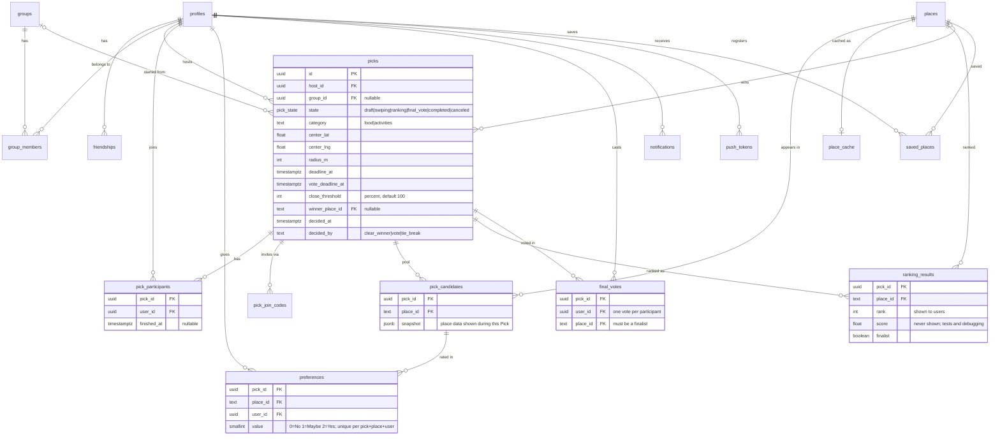
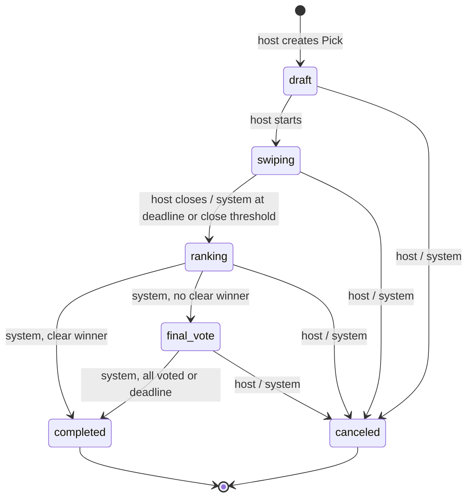
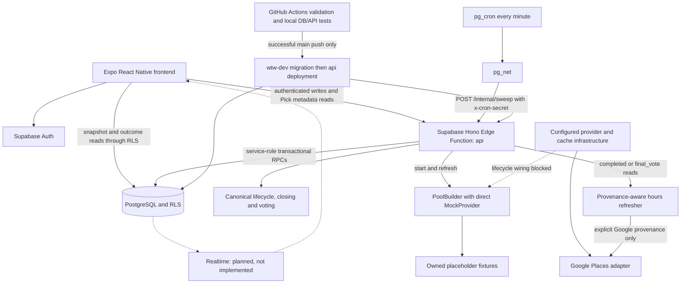

# WTW Design Document

Sections are owned by the person named in each heading. The Week 4 architecture/status below describes the current implementation; M2 UI and requirement-map sections retain historical milestone context.

## Data model (Alan)

Postgres (Supabase) is the source of truth. Clients read through RLS; **only our API writes** (service role).
Columns below are the ones the decision engine relies on; Razin's migration is authoritative for the rest.



| Table | Purpose |
|---|---|
| `profiles` | One row per account (created on first sign-in). |
| `friendships` | Friend requests, accepted friends, blocks. |
| `groups`, `group_members` | Reusable groups for repeat Picks. |
| `picks` | One decision session: host, category, center + radius, deadline, close threshold, state, and the stored winner (`winner_place_id`, `decided_at`, `decided_by`). |
| `pick_participants` | Who is in a Pick and whether they finished swiping. |
| `pick_join_codes` | 6-character join codes / QR / `wtw://join/CODE` links. |
| `places`, `place_cache` | Normalized places; cache table remains proposed. Google content has field-specific storage restrictions, not a blanket 30-day TTL; see [Phase 1 policy](places-phase1.md). |
| `pick_candidates` | The fixed, shared pool for one Pick (snapshot, so history does not change when a place does). |
| `preferences` | Each participant's private Yes/Maybe/No per candidate. |
| `ranking_results` | Output of the ranking engine for a Pick. |
| `final_votes` | One ballot per participant among the finalists. |
| `notifications`, `push_tokens` | Invitation and Pick-status notifications. |
| `saved_places` | Ideas saved from Discover. |

## Pick state machine (Alan)

Code: `supabase/functions/_shared/domain/pickState.ts` (`canTransition(from, to, actor)`; `dueToClose` for the deadline / close-threshold rule).
The API is the only writer of `picks.state` and rejects every action that does not belong to the current state
(for example a swipe after ranking, or a vote for a non-finalist).

**Lifecycle routes (Week 2):** `POST /picks` (create), `POST /picks/:id/start`, `POST /picks/:id/refresh`
(free before anyone swipes; `{confirm:true}` and clears every answer once swiping has started),
`POST /picks/:id/cancel`, `GET /picks/:id` (candidates in a per-caller deterministic shuffle,
`_shared/domain/shuffle.ts`). `start`/`refresh` pull candidates through `PoolBuilder`
(`_shared/places/pool.ts`), currently backed by `MockProvider`. The configured Google
builder exists, but safe persistence/ranking integration remains blocked. RPCs: `pick_create`, `pick_load`,
`pick_start`, `pick_refresh`, `pick_cancel` (`supabase/migrations/0003_pick_lifecycle.sql`).

**Closing and voting (Week 3):** `closePick` (`_shared/api/closing.ts`) runs the swiping → ranking
step (reusing `rankCandidates`/`clearWinner`) for a host-triggered `POST /picks/:id/close`, for the
auto-close check after every swipe once `close_threshold` is met, and through Josh's implemented
deadline sweep for a passed deadline; it is idempotent (a race just reports the already-decided result).
`castVote`/`closeVote`/`closeVoteByDeadline` (`_shared/api/voting.ts`) back `POST /picks/:id/vote`
and `POST /picks/:id/close-vote`, tallying with `voteWinner` (most votes → higher score → closer to
the center → place id, via the stored `rank`). RPCs: `pick_load_for_close`, `pick_close_apply`,
`pick_load_for_vote`, `pick_cast_vote`, `pick_close_vote_apply`
(`supabase/migrations/0004_pick_close_and_vote.sql`), plus the new `final_votes` table (one
changeable ballot per participant, readable only by its own author).
Entering `final_vote` sets `picks.vote_deadline_at` (now + `VOTE_WINDOW_MS`, 30 min), separate
from the swipe deadline `deadline_at`, which has usually passed by then. The implemented deadline sweep selects `state = 'final_vote' and vote_deadline_at <= now()` and calls `closeVoteByDeadline`, which
rechecks the deadline itself.



| From → To | Host | Participant | System |
|---|---|---|---|
| draft → swiping | ✅ | ❌ | ❌ |
| swiping → ranking | ✅ (close manually) | ❌ | ✅ (deadline, or X% finished) |
| ranking → completed | ❌ | ❌ | ✅ (clear winner) |
| ranking → final_vote | ❌ | ❌ | ✅ (no clear winner) |
| final_vote → completed | ❌ | ❌ | ✅ (all voted, or deadline) |
| any unfinished → canceled | ✅ | ❌ | ✅ (e.g. stale Pick sweep) |
| completed / canceled → anything | ❌ | ❌ | ❌ |

"System" means our API acting on its own authority: the `pg_cron` deadline sweep, the close-threshold check after a swipe, and the ranking step itself.
Participants never change the state; they only swipe and vote. Refreshing the candidate pool stays in `swiping` (after swiping has started it asks for confirmation and resets everyone's answers).

## Scoring (Alan)

Code: `supabase/functions/_shared/domain/ranking.ts` (`scoreCandidate`, `rankCandidates`, `clearWinner`); tests in `tests/domain/ranking.test.ts`.
This is a transparent formula, not an AI prediction.

**Per candidate**, with `n` participants and answers Yes = 1, Maybe = 0.5, No = 0, **missing = 0.5 (counts as Maybe)**:

| Term | Definition |
|---|---|
| preference | mean of all `n` values |
| consensus | 1 − (population std-dev of the `n` values ÷ 0.5) |
| coverage | people who actually answered ÷ `n` |
| noProportion | number of No answers ÷ `n` |

```
score = 100 × (0.70·preference + 0.20·consensus + 0.10·coverage) − 15·noProportion,   clamped to 0–100
```

**Worked example: broad enthusiasm with one objection vs. lukewarm agreement**

| Answers (n = 4) | preference | consensus | coverage | noProportion | score |
|---|---|---|---|---|---|
| Yes, Yes, Yes, No | 0.75 | 0.134 | 1 | 0.25 | **61.4** |
| Maybe × 4 | 0.50 | 1.000 | 1 | 0 | **65.0** |

Complete moderate agreement edges out a divisive option: one strong "No" costs both consensus and the −15 penalty.
Other reference points (all locked by tests): all Yes = 100, all No = 15, nobody answered = 55, 3 Maybe + 1 missing = 62.5.

**Ordering ties:** score (desc) → distance from the Pick center (asc, haversine) → place id (asc). The result is deterministic.

**Clear winner:** if only one candidate exists, or #1 beats #2 by **≥ 10 points**, #1 wins and the final vote is skipped.
Otherwise the group votes among the top 3 (or the 1–2 that exist). If #1 is tied, it is never a clear winner; everyone tied for #1 is a finalist, even if that makes more than 3.
Float noise is ignored (differences under 1e-9 count as equal), so an exact 10-point gap always counts.

**Final-vote tie-break:** most votes → higher score → closer to the center → place id (`voteWinner`; no ballots by the deadline means #1 wins).

**What users see:** rank only (1st / 2nd / 3rd, or "Clear winner!"). Scores are stored in `ranking_results.score` for tests and debugging and are never sent to the app.

**Input mapping:** `preferences.value` is 0 = No, 1 = Maybe, 2 = Yes; `answerFromDb` converts it before scoring.

**Open question for the team:** the weights (0.70 / 0.20 / 0.10, −15) are a starting hypothesis. M5 user sessions should tell us whether one "No" is penalized enough.

## What changed since M1 (Mike)

| Topic | In M1 | Decision now |
|---|---|---|
| Platform | The proposal said web app; the M1 slides said native apps. | **Native, via Expo + React Native** (one TypeScript codebase for iOS and Android). |
| Group location | A "fair radius for the group" computed from everyone's location. | **The host picks the center and radius** when creating the Pick (`picks.center_lat`, `center_lng`, `radius_m`). |
| Guests | Guests could take part. | **An account is required** to join a Pick. |
| Score | Users see a WTW Match Score. | **Users see rank only** (1st / 2nd / 3rd, or "Clear winner!"). Scores stay server-side; see [Scoring](#scoring-alan). |

## UI flow (Mike)

The four M2 screens, in order. Every screen also runs without a backend in mock mode
(`EXPO_PUBLIC_USE_MOCK=1`, local fixture of 20 places; sign-in code `123456`).

1. **Sign in**: enter email, then the 6-digit code from the email (`signInWithOtp`, then `verifyOtp` with type `email`). Wrong or expired codes show an error; "Resend code" unlocks after 60 s.

   

2. **Home**: the Picks I'm a participant in. Tapping a Pick opens Swipe (while swiping) or Results (after ranking).

   

3. **Swipe**: one card at a time (photo, name, price level, rating) with Yes / Maybe / No buttons or a swipe (right = Yes, left = No, up = Maybe). Shows progress ("7 / 20"), resumes at my first unanswered card, saves each answer optimistically and offers Retry if a save fails. Once every answer is saved, the **host** sees "Rank" (which closes swiping for everyone); other participants see "Waiting for the host".

   

4. **Results**: the host’s Rank calls `POST /picks/:id/rank`; everyone else sees "Waiting for the host" until then, and reads the stored result afterwards. Shows rank only: 1st / 2nd / 3rd with name and photo, or "Clear winner!" with one place. No scores anywhere.

   

## Requirement → component map (Mike)

Historical M2 milestone map (not a current backend implementation inventory; see the Week 4 architecture and API list below). M2 implements FR-01 (sign-in part), FR-09, FR-10, FR-11 and FR-13. Everything else is planned for M3 or later.
Owners follow the README ownership table; owners, please correct your rows.

| FR | Requirement | Screen | API route | Table(s) | Owner | Milestone |
|---|---|---|---|---|---|---|
| FR-01 | Create an account, sign in, sign out, and maintain a profile. | Sign in; sign out on Home. Profile: planned | None (Supabase Auth `signInWithOtp` / `verifyOtp`) | `profiles` | Razin (auth), Mike (screens) | M2 (sign-in); profile M3+ |
| FR-02 | Complete and later edit a short preference profile. | planned | planned | `profiles` | Razin | M3+ |
| FR-03 | Send, accept, remove, and block friend relationships. | planned | planned | `friendships` | Razin | M3+ |
| FR-04 | Create, name, and manage a reusable group. | planned | planned | `groups`, `group_members` | Razin | M3+ |
| FR-05 | Create a Pick for selected friends or a saved group. | planned | planned | `picks`, `pick_participants` | Alan | M3+ |
| FR-06 | Select Food or Activities and optionally refine location, radius, price, and open status. | planned | planned | `picks` | Josh | M3+ |
| FR-07 | Retrieve and normalize a bounded nearby candidate pool. | planned | planned | `places`, `place_cache`, `pick_candidates` | Josh | M3+ |
| FR-08 | Join an authorized Pick through the app or invitation link. | planned | planned | `pick_join_codes`, `pick_participants` | Razin | M3+ |
| FR-09 | Record exactly one Yes, Maybe, or No response per candidate and revise it before closure. | Swipe (buttons, gesture, Back to revise) | `POST /picks/:id/swipes` | `preferences`, `pick_candidates` | Alan (responses), Mike (screen) | M2 |
| FR-10 | Persist responses and restore progress after refresh or reconnection. | Swipe (resumes at first unanswered card) | `POST /picks/:id/swipes`; own answers read through RLS | `preferences` | Mike | M2 |
| FR-11 | Hide individual responses until aggregation is complete. | Swipe, Results (no one else's answers shown) | None (RLS: participants read only their own `preferences`) | `preferences` | Razin (RLS) | M2 |
| FR-12 | Close responses after all participants finish or according to a documented timeout rule. | planned | planned | `picks`, `pick_participants` | Alan | M3+ |
| FR-13 | Calculate deterministic group scores and return the top three candidates. | Results (rank only) | `POST /picks/:id/rank` | `ranking_results`, `picks` | Alan | M2 |
| FR-14 | Provide a plain-language explanation for each top result. **Revised: rank + plain-language reason, no number** (conflicts with the rank-only decision). | planned | planned | `ranking_results` | Alan | M3+ |
| FR-15 | Vote once among the three finalists. | planned | planned | `final_votes` | Mike | M3+ |
| FR-16 | Resolve ties, declare one winner, and save the outcome. | planned | planned | `picks`, `final_votes` | Alan | M3+ |
| FR-17 | Browse a bounded individual Discover feed and save interests. | planned | planned | `places`, `saved_places` | Josh | M3+ |
| FR-18 | View completed Pick history for groups they belong to. | planned | planned | `picks`, `groups`, `group_members` | Razin | M3+ |
## Architecture (Josh)



### Implementation and verification status

| Status | Current evidence / boundary |
| --- | --- |
| **IMPLEMENTED** | Lifecycle create/start/refresh/cancel/read, canonical close/vote paths, deadline sweep, read-time opening-hours integration, provider infrastructure, and main-to-wtw-dev CD workflow. |
| **CI VERIFIED** | PR `CI / validate` and `CI / Local database and API` pass. Validation includes lint, types, Jest, Android bundle, Deno checks/route tests; integration runs local migrations/seed, pgTAP/RLS and HTTP/database tests. PR deployment correctly skips. Hours integration is covered by CI. |
| **HOSTED VERIFIED** | No hosted CD, cron delivery, or real backend Google request has been verified for this work. Green CI tests local services/mocks, not hosted wtw-dev behavior. |
| **BLOCKED/PLANNED** | Google lifecycle persistence/display hydration and durable Places cache await a safe data contract. Realtime subscriptions are planned and not operational. |

Clients use Supabase Auth and RLS-filtered reads. Application writes go through the
single `api` Edge Function. Alan's canonical `closePick` handles host/system closure;
auto-close checks run after swipes, and the deadline sweep delegates to the same
closers. Ranking decisions, voting, and winner selection remain canonical domain
logic backed by transactional RPCs.

`pg_cron`/`pg_net` scheduling is implemented in migration `0005`. The internal sweep
uses `deadline_at` for swiping and `vote_deadline_at` for final votes, authenticated
by a separate server secret rather than a user token. Hosted Edge secret/Vault
configuration and delivery verification remain required. See
[cron configuration](api-integration.md#cron-and-wtw-dev-configuration).

Results/reveal candidate reads retain persisted identities/display snapshots and
request additional metadata from the existing authenticated `GET /picks/:id`.
After membership validation, completed/final-vote reads call `refreshOpenHours`.
Fresh owned mock hours are evaluated; stale/missing hours remain unknown. Explicit
Google provenance permits request-time hours lookup without persistence. Failures
never replace candidates or change ranks, winners, votes, or state. The client adds
optional `openNow`/`closesAt`; this does not add hours labels to the screen layout.

### Real versus mock

| Path | Implemented behavior | Runtime / verification limit |
| --- | --- | --- |
| Lifecycle mock | `api/index.ts` directly constructs `createPoolBuilder(new MockProvider())`; start/refresh persist owned candidate snapshots. | Current active lifecycle provider. Bundled placeholders differ from the SBU database demo seed; no hosted lifecycle proof is claimed. |
| Google provider | Search normalization, request timeouts, hours details, provenance and cache safeguards exist. | Unit/CI tested with synthetic responses; no verified real backend Google request. |
| Google → mock fallback | Configured pool tries mock on Google failure, timeout or unusable response; fallback does not poison Google cache. | Tested infrastructure, not connected to lifecycle; geographically limited fixtures can also yield no candidates. |
| `PLACES_PROVIDER` | Configured builder reads `google`/`mock` on each build, defaults to mock, rejects invalid configuration. | Lifecycle bypasses that builder. An env change alone cannot enable Google discovery. |
| Cache | Bounded in-memory mock cache and Google-ID-only entries; no durable Places cache adapter/table. | Configured cache is not injected into current lifecycle; Google IDs do not substitute for fresh display content. |
| Whole-app mock | `EXPO_PUBLIC_USE_MOCK` selects frontend simulation. | Separate from server provider selection; not evidence of backend integration. |

Google lifecycle integration is blocked at persistence, not by a missing adapter.
Start/refresh currently store full candidates in `places.raw` and Pick snapshots;
closing reads frozen candidate coordinates to calculate distance tie-breaks. Our
Google candidates are marked request-only. The existing snapshot guard is not yet
wired into that boundary. ID-only storage plus display hydration would still need
a permitted stable ranking input. Computing distance locally does not establish
permission to retain that derived value. Do not weaken the guard or alter Alan's
ranking to bypass this unresolved contract. See [Places details](places-phase1.md).

The legacy `/rank` route still exists and is used by the current UI when a host
opens results while the Pick remains swiping. It is not the canonical `/close`
path; the earlier integration review identified its missing final-vote deadline.
Coordinate retirement/delegation with Alan and client migration with Mike. Neither
green sweep tests nor this documentation update resolves that separate path.

### CI/CD and synchronization

The CD job depends on both CI jobs, runs only for pushes to main, checks out the
validated commit, and serializes wtw-dev deployments without canceling active work.
A current-main check skips superseded queued commits. It links the hosted project,
applies pending migrations, then deploys `api`; it never resets/seeds hosted data
or configures application secrets. Function failure leaves applied migrations in
place; use compatible migrations and forward-fix recovery. Hosted execution is
not yet tested. See [deployment setup](api-integration.md#main-to-wtw-dev-deployment).

Realtime is not implemented. The current results screen loads/reloads state through
reads rather than subscriptions. Future subscription scope and ownership must be
agreed without exposing private answers or ranking scores.

## Stack + why (Josh)

| Technology | Why |
|---|---|
| Expo / React Native | One mobile codebase supports iOS and Android with quick device iteration. |
| TypeScript | Shared types connect the app, API and pure decision engine. |
| Supabase Auth | Managed identity verifies users without a custom password system. |
| Supabase Postgres + RLS | Relational constraints and row policies protect shared Pick data. |
| Supabase Realtime | Planned only; current clients use explicit reads/reloads. |
| Supabase Edge Functions | A server runtime keeps credentials and privileged operations off phones. |
| Hono | A small router gives the single API explicit routes and error handling. |
| Our TypeScript API | One write boundary enforces authorization, state and ranking rules. |
| PlaceProvider / Google Places abstraction | Stable normalized candidates let mock data become live discovery later. |
| Jest | Repeatable tests exercise shared logic without a phone or database. |
| GitHub Actions | PR/main CI validates code, bundle, local database/API; successful main runs are configured to deploy to wtw-dev. Hosted CD is unverified. |
## Security & privacy (Razin)

Code: `supabase/migrations/0001_init.sql`, `0002_heartbeat_rpcs.sql`; tests in `supabase/tests/rls_test.sql` (`supabase db reset && supabase test db`).

**One writer.** Only the `api` Edge Function writes to Postgres, using the service role on the server. The app gets **no** INSERT / UPDATE / DELETE: no table grants and no write policies. Even a bug in the app, or a user with a modified client, cannot change a Pick, a swipe or a result directly.

**Reads are filtered by RLS on every table.** The app reads as `authenticated` (never `anon`):

| Table | A signed-in user can SELECT |
|---|---|
| `picks`, `pick_participants`, `pick_candidates`, `ranking_results` | rows of Picks they participate in |
| `preferences` | **only their own** answers (nobody sees how others swiped) |
| `profiles` | their own, and people they share a Pick with |
| `places` | places that are candidates in one of their Picks |

Membership checks use `private.*` helpers (security definer, empty `search_path`) in a schema the Data API does not expose.

**Explicit grants.** The hosted project does not auto-expose new tables, and the migration does not rely on defaults either: it revokes everything from `anon` and `authenticated`, then grants `SELECT` to `authenticated` table by table and `ALL` to `service_role`. New tables must add their own RLS policy **and** grant, or the app cannot see them.

**Scores stay on the server.** `ranking_results.score` has no client grant (column-level `SELECT` on `pick_id, place_id, rank, finalist, created_at` only). `select=*` from the app fails with `permission denied`, so a careless query errors instead of leaking. The API also never returns scores. `ranking_results` is intentionally **not** in the Realtime publication, because Realtime would ship whole rows.

**Server-only RPCs.** `heartbeat_*` functions are executable only by `service_role`; they re-check membership, host, state and version inside one locked transaction, so forged user ids or stale requests are rejected (PT403 / PT409).

**Authentication.** Email one-time code (6 digits, 1-hour expiry); no passwords are stored. The API verifies user mutations with `getUser(req)` (`supabase/functions/_shared/auth/getUser.ts`), which asks Supabase Auth to validate the token rather than decoding it, so signed-out or deleted users are rejected. A `profiles` row is created automatically on first sign-in.

**Data we keep.** `profiles` holds a display name and avatar URL only; email lives in Supabase Auth and is never exposed to other users. Preferences are private to their author. Place data is a snapshot per Pick so history does not change later.

**Secrets.** No keys or passwords are committed. The service-role key exists only as an Edge Function secret; the app ships only the public anon/publishable key, which is useless without a user session because `anon` has no table grants.

**Not covered yet:** rate limiting on the API, account deletion flow, join-code brute force protection (M3 with `pick_join_codes`).

## API list (Razin; implementation status refreshed)

Base URL: `<SUPABASE_URL>/functions/v1/api`. User routes need `Authorization: Bearer <user access token>`. `/health` is public; `/internal/sweep` instead requires `x-cron-secret`. Errors are `{ "error": { "code", "message" } }` with 400 / 401 / 403 / 404 / 409 / 500 / 503. Details of the implemented routes: `docs/api-integration.md` (Josh).

**Writes (through the API only)**

| Method & path | Who | What | Status |
|---|---|---|---|
| `GET /health` | anyone | liveness | implemented |
| `POST /picks/:id/swipes` | participant, Pick `swiping` | `{ placeId, value: 0\|1\|2 }` upserts my answer | implemented |
| `POST /picks/:id/rank` | host, Pick `swiping` | close swiping, rank, store results; returns top 3 + decision (no scores) | implemented |
| `POST /picks` | signed-in user | create a Pick (category, center, radius, deadline, close threshold) | implemented |
| `POST /picks/:id/candidates` | — | historical proposal; pool construction is in start/refresh | not implemented |
| `POST /picks/:id/start` | host, `draft` | build mock pool; `draft → swiping` | implemented |
| `POST /picks/join` | signed-in user | join by 6-character code | planned |
| `POST /picks/:id/finish` | — | historical proposal; canonical close counts saved answers | not implemented |
| `POST /picks/:id/vote` | participant, `final_vote` | `{ placeId }` for a finalist | implemented |
| `POST /picks/:id/cancel` | host | any unfinished state → `canceled` | implemented |
| `POST /picks/:id/refresh` | host | replace pool with confirmation after answers | implemented |
| `POST /picks/:id/close` | host | canonical swiping close | implemented |
| `POST /picks/:id/close-vote` | host | canonical final-vote close | implemented |
| `GET /picks/:id` | participant | Pick read plus reveal hours metadata | implemented |
| `POST /internal/sweep` | cron secret | delegate expired Picks to canonical closers | implemented; hosted delivery unverified |
| `PATCH /me` | signed-in user | update display name / avatar | planned |

**Database RPCs used by the API** (service role only, `0002_heartbeat_rpcs.sql`)

| Function | Returns / effect |
|---|---|
| `heartbeat_load_pick(p_pick_id, p_user_id)` | `PickSnapshot` json (id, hostId, state, center, participantIds, candidates, preferences, version) or null |
| `heartbeat_upsert_swipe(p_pick_id, p_user_id, p_place_id, p_value)` | upserts one preference, advances version |
| `heartbeat_save_ranking(p_pick_id, p_user_id, p_version, p_ranking)` | `swiping → ranking → completed \| final_vote`, replaces `ranking_results`, sets winner metadata |

**Reads (app → Supabase directly, filtered by RLS)**

| Query | Used for |
|---|---|
| `pick_participants?select=picks(id,state,category,deadline_at)&user_id=eq.<me>` | my Picks |
| `pick_candidates?select=place_id,snapshot&pick_id=eq.<id>` | swipe cards |
| `preferences?select=place_id,value&pick_id=eq.<id>&user_id=eq.<me>` | resume swiping |
| `ranking_results?select=place_id,rank,finalist&pick_id=eq.<id>` | results (never `score`) |
| `picks?select=state,host_id,winner_place_id,decided_by&id=eq.<id>` | outcome / host check |
