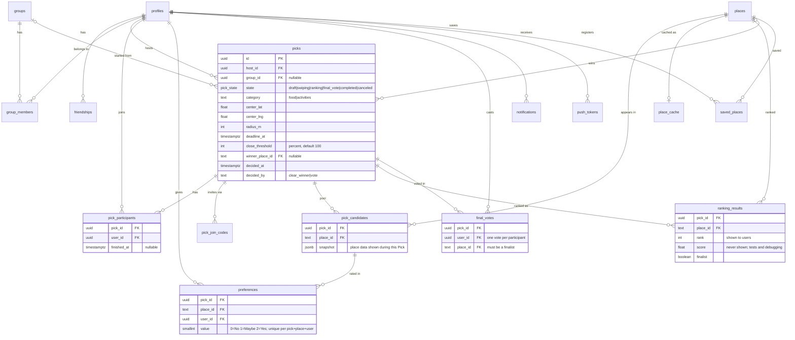
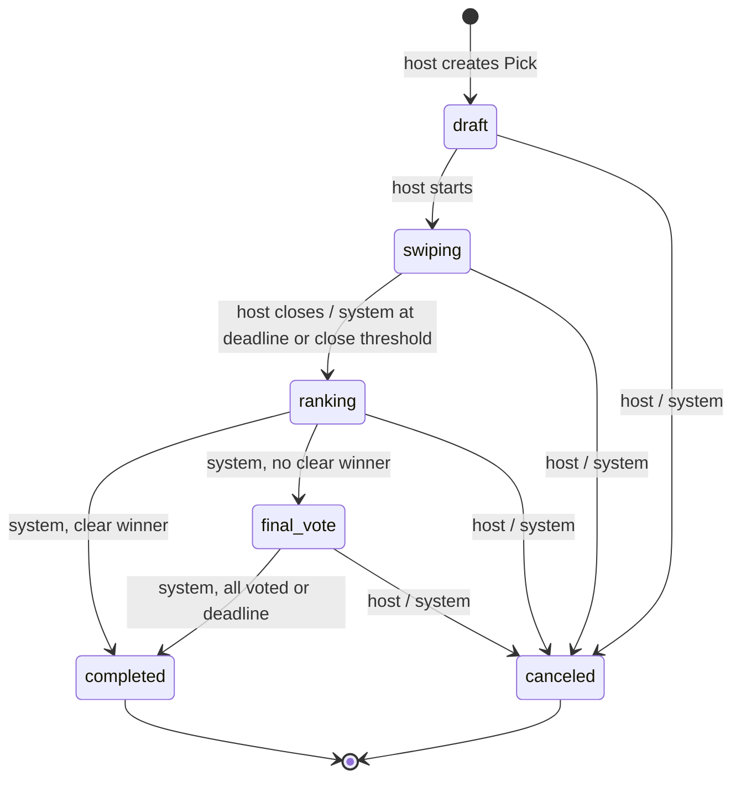
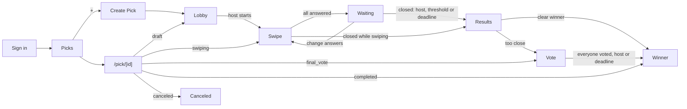
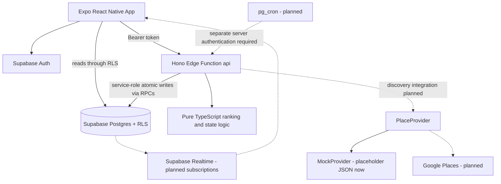

# WTW Design Document (M2)

Sections are owned by the person named in each heading. Fill yours in on your own branch.

## Data model (Alan)

Postgres (Supabase) is the source of truth. Clients read through RLS; **only our API writes** (service role).
Columns below are the ones the decision engine relies on; Razin's migration is authoritative for the rest.



| Table | Purpose |
|---|---|
| `profiles` | One row per account (created on first sign-in). |
| `friendships` | Friend requests, accepted friends, blocks. |
| `groups`, `group_members` | Reusable groups for repeat Picks. |
| `picks` | One decision session: host, category, center + radius, deadline, close threshold, state, and the stored winner (`winner_place_id`, `decided_at`, `decided_by`). |
| `pick_participants` | Who is in a Pick and whether they finished swiping. |
| `pick_join_codes` | 6-character join codes / QR / `wtw://join/CODE` links. |
| `places`, `place_cache` | Normalized provider places; cached provider data (30-day TTL, subject to Google's terms). |
| `pick_candidates` | The fixed, shared pool for one Pick (snapshot, so history does not change when a place does). |
| `preferences` | Each participant's private Yes/Maybe/No per candidate. |
| `ranking_results` | Output of the ranking engine for a Pick. |
| `final_votes` | One ballot per participant among the finalists. |
| `notifications`, `push_tokens` | Invitation and Pick-status notifications. |
| `saved_places` | Ideas saved from Discover. |

## Pick state machine (Alan)

Code: `supabase/functions/_shared/domain/pickState.ts` (`canTransition(from, to, actor)`; `dueToClose` for the deadline / close-threshold rule).
The API is the only writer of `picks.state` and rejects every action that does not belong to the current state
(for example a swipe after ranking, or a vote for a non-finalist).

**Lifecycle routes (Week 2):** `POST /picks` (create), `POST /picks/:id/start`, `POST /picks/:id/refresh`
(free before anyone swipes; `{confirm:true}` and clears every answer once swiping has started),
`POST /picks/:id/cancel`, `GET /picks/:id` (candidates in a per-caller deterministic shuffle,
`_shared/domain/shuffle.ts`). `start`/`refresh` pull candidates through `PoolBuilder`
(`_shared/places/pool.ts`), currently backed by `MockProvider` until Josh's Google Places
`buildPool` (Week 2) drops in behind the same interface. RPCs: `pick_create`, `pick_load`,
`pick_start`, `pick_refresh`, `pick_cancel` (`supabase/migrations/0003_pick_lifecycle.sql`).

**Closing and voting (Week 3):** `closePick` (`_shared/api/closing.ts`) runs the swiping → ranking
step (reusing `rankCandidates`/`clearWinner`) for a host-triggered `POST /picks/:id/close`, for the
auto-close check after every swipe once `close_threshold` is met, and — once Josh's deadline sweep
calls it — for a passed deadline; it is idempotent (a race just reports the already-decided result).
`castVote`/`closeVote`/`closeVoteByDeadline` (`_shared/api/voting.ts`) back `POST /picks/:id/vote`
and `POST /picks/:id/close-vote`, tallying with `voteWinner` (most votes → higher score → closer to
the center → place id, via the stored `rank`). RPCs: `pick_load_for_close`, `pick_close_apply`,
`pick_load_for_vote`, `pick_cast_vote`, `pick_close_vote_apply`
(`supabase/migrations/0004_pick_close_and_vote.sql`), plus the new `final_votes` table (one
changeable ballot per participant, readable only by its own author).
Entering `final_vote` sets `picks.vote_deadline_at` (now + `VOTE_WINDOW_MS`, 30 min), separate
from the swipe deadline `deadline_at`, which has usually passed by then. The deadline sweep should
select `state = 'final_vote' and vote_deadline_at <= now()` and call `closeVoteByDeadline`, which
rechecks the deadline itself.



| From → To | Host | Participant | System |
|---|---|---|---|
| draft → swiping | ✅ | ❌ | ❌ |
| swiping → ranking | ✅ (close manually) | ❌ | ✅ (deadline, or X% finished) |
| ranking → completed | ❌ | ❌ | ✅ (clear winner) |
| ranking → final_vote | ❌ | ❌ | ✅ (no clear winner) |
| final_vote → completed | ❌ | ❌ | ✅ (all voted, or deadline) |
| any unfinished → canceled | ✅ | ❌ | ✅ (e.g. stale Pick sweep) |
| completed / canceled → anything | ❌ | ❌ | ❌ |

"System" means our API acting on its own authority: the `pg_cron` deadline sweep, the close-threshold check after a swipe, and the ranking step itself.
Participants never change the state; they only swipe and vote. Refreshing the candidate pool stays in `swiping` (after swiping has started it asks for confirmation and resets everyone's answers).

## Scoring (Alan)

Code: `supabase/functions/_shared/domain/ranking.ts` (`scoreCandidate`, `rankCandidates`, `clearWinner`); tests in `tests/domain/ranking.test.ts`.
This is a transparent formula, not an AI prediction.

**Per candidate**, with `n` participants and answers Yes = 1, Maybe = 0.5, No = 0, **missing = 0.5 (counts as Maybe)**:

| Term | Definition |
|---|---|
| preference | mean of all `n` values |
| consensus | 1 − (population std-dev of the `n` values ÷ 0.5) |
| coverage | people who actually answered ÷ `n` |
| noProportion | number of No answers ÷ `n` |

```
score = 100 × (0.70·preference + 0.20·consensus + 0.10·coverage) − 15·noProportion,   clamped to 0–100
```

**Worked example: broad enthusiasm with one objection vs. lukewarm agreement**

| Answers (n = 4) | preference | consensus | coverage | noProportion | score |
|---|---|---|---|---|---|
| Yes, Yes, Yes, No | 0.75 | 0.134 | 1 | 0.25 | **61.4** |
| Maybe × 4 | 0.50 | 1.000 | 1 | 0 | **65.0** |

Complete moderate agreement edges out a divisive option: one strong "No" costs both consensus and the −15 penalty.
Other reference points (all locked by tests): all Yes = 100, all No = 15, nobody answered = 55, 3 Maybe + 1 missing = 62.5.

**Ordering ties:** score (desc) → distance from the Pick center (asc, haversine) → place id (asc). The result is deterministic.

**Clear winner:** if only one candidate exists, or #1 beats #2 by **≥ 10 points**, #1 wins and the final vote is skipped.
Otherwise the group votes among the top 3 (or the 1–2 that exist). If #1 is tied, it is never a clear winner; everyone tied for #1 is a finalist, even if that makes more than 3.
Float noise is ignored (differences under 1e-9 count as equal), so an exact 10-point gap always counts.

**Final-vote tie-break:** most votes → higher score → closer to the center → place id (`voteWinner`; no ballots by the deadline means #1 wins).

**What users see:** rank only (1st / 2nd / 3rd, or "Clear winner!"). Scores are stored in `ranking_results.score` for tests and debugging and are never sent to the app.

**Input mapping:** `preferences.value` is 0 = No, 1 = Maybe, 2 = Yes; `answerFromDb` converts it before scoring.

**Open question for the team:** the weights (0.70 / 0.20 / 0.10, −15) are a starting hypothesis. M5 user sessions should tell us whether one "No" is penalized enough.

## What changed since M1 (Mike)

| Topic | In M1 | Decision now |
|---|---|---|
| Platform | The proposal said web app; the M1 slides said native apps. | **Native, via Expo + React Native** (one TypeScript codebase for iOS and Android). |
| Group location | A "fair radius for the group" computed from everyone's location. | **The host picks the center and radius** when creating the Pick (`picks.center_lat`, `center_lng`, `radius_m`). |
| Guests | Guests could take part. | **An account is required** to join a Pick. |
| Score | Users see a WTW Match Score. | **Users see rank only** (1st / 2nd / 3rd, or "Clear winner!"). Scores stay server-side; see [Scoring](#scoring-alan). |

## Updated for M3: what changed (Mike)

- **The whole loop has screens**: Create → Lobby (code + QR + Share) → Swipe → Waiting → Results → Vote → Winner, plus a canceled / offline / not-found view. Every screen follows the Pick's state by itself (see [UI flow](#ui-flow-mike)).
- **Live progress without leaking answers**: the app subscribes to Supabase Realtime on `picks` and `pick_participants` only. `pick_participants.finished_at` is kept current by a trigger (`0005_live_progress.sql`), so the socket carries "who's done", never answers. If the channel fails, the app polls `GET /picks/:id/progress` every 5 s. `preferences`, `final_votes` and `ranking_results` are **not** in the publication.
- **Per-person deck**: Swipe reads `GET /picks/:id` (Alan), which returns the candidates in my own shuffled order plus my answers, instead of reading `pick_candidates` in place-id order.
- **Rank stays rank-only**: Results shows 1st / 2nd / 3rd and "Clear winner!"; the vote shows finalists by rank; the API and reads never carry scores.
- **Look**: the live-demo styling (dark, flame gradient, Poppins, Tinder-style deck, confetti reveal) is now the app's look; shared pieces live in `src/components` (`PickParts`, `ResultCards`, `HostMenu`).
- **Mock mode plays the whole loop**: Ava, Ben and Cam join, swipe and vote on timers, using the shared ranking and vote rules, so the demo runs without a network (`EXPO_PUBLIC_USE_MOCK=1`).

## UI flow (Mike)

Every Pick screen calls `usePickLive` (state + progress) and `usePickRoute` (which screen belongs to the state). Opening a Pick from anywhere goes to `/pick/[id]`, which forwards to the current step, so a late arrival lands in the right place.



| Pick state | Screen(s) | What it shows |
|---|---|---|
| `draft` | Lobby | Who's in (live), join code + QR + Share, settings (radius, pool, deadline, close rule). Host: Start (needs 2 people), Cancel. |
| `swiping` | Swipe, then Waiting | Swipe: my shuffled deck, resume at first unanswered, Back to change, details sheet, "X of N friends done", deadline countdown; host menu (Close now, Get new places with a reset warning, Cancel). Waiting: "3 of 5 finished swiping", avatars with checks (never answers), countdown, host Close now / Cancel, Change my answers. |
| `ranking` | Results | "Counting everyone's swipes…" |
| `final_vote` | Results → Vote | Results: "Too close to call", finalists by rank. Vote: tap a finalist (radio group), change until it closes, "2 of 4 voted"; host Close the vote. Late arrivals go straight to Vote. |
| `completed` | Results → Winner | Results: "Clear winner!" or "Decided!", 1st/2nd/3rd (rank only). Winner: the place, how it was decided (clear winner / vote / tie-break), Directions (Apple Maps on iOS, Google Maps elsewhere), "Saved to your history". |
| `canceled` | `/pick/[id]` | "This Pick was canceled", Start a new Pick. |
| any, offline | same screen | Last good data stays, a banner says we're retrying (polling every 5 s), Try again. Before anything loaded: "You're offline" with Try again. |

**Accessibility.** Every tappable is ≥ 44 pt (`MIN_TARGET`). Yes / Maybe / No buttons are labelled with the place ("Yes to Kung Fu Tea"); the vote list is a radio group whose items say rank, name and "your vote"; progress counts are a polite live region; avatars announce "Ava, done". Text follows the system font scale (no fixed-height text boxes), long names wrap to two lines instead of being cut, and inputs on Create Pick stay above the keyboard (`KeyboardAvoidingView` in `Screen`).

Screens (mock mode, 375 × 812 viewport):

| Picks | Lobby | Swipe | Waiting |
|---|---|---|---|
|  |  |  |  |

| Results | Vote | Winner |
|---|---|---|
|  |  |  |

## Requirement → component map (Mike)

Status as of M3 (Oct 21). "Screen done" means the app side is built and runs end to end in mock mode; the matching API route's PR is listed where it isn't merged yet.

| FR | Requirement | Screen | API route | Table(s) | Owner | Status |
|---|---|---|---|---|---|---|
| FR-01 | Create an account, sign in, sign out, and maintain a profile. | Sign in; Profile tab (sign out) | None (Supabase Auth) | `profiles` | Razin (auth), Mike (screens) | Sign-in done; profile editing: Razin |
| FR-02 | Complete and later edit a short preference profile. | planned | planned | `profiles` | Razin | M4 |
| FR-03 | Send, accept, remove, and block friend relationships. | Friends tab (placeholder) | planned | `friendships` | Razin | M4 |
| FR-04 | Create, name, and manage a reusable group. | planned | planned | `groups`, `group_members` | Razin | M4 |
| FR-05 | Create a Pick for selected friends or a saved group. | Create Pick → Lobby | `POST /picks` (PR #12) | `picks`, `pick_participants` | Alan, Mike (screens) | **Done** by join code; friends/groups M4 |
| FR-06 | Select Food or Activities and optionally refine location, radius, price, and open status. | Create Pick (map pin, search, radius, pool, deadline, close rule) | `POST /picks` | `picks` | Josh, Mike (screen) | **Done**; price/open filters M4 |
| FR-07 | Retrieve and normalize a bounded nearby candidate pool. | Lobby Start; host "Get new places" | `POST /picks/:id/start`, `/refresh` (PR #12) | `places`, `place_cache`, `pick_candidates` | Josh, Alan | API in review |
| FR-08 | Join an authorized Pick through the app or invitation link. | Lobby shows code + QR + Share (`wtw://join/CODE`) | `POST /picks/join` (Razin) | `pick_join_codes`, `pick_participants` | Razin, Mike (lobby) | **Done**: code, QR/link (`app/join/[code].tsx`), Picks-tab "Join with code" |
| FR-09 | Record exactly one Yes, Maybe, or No response per candidate and revise it before closure. | Swipe (buttons, gesture, Back, Change my answers) | `POST /picks/:id/swipes` | `preferences` | Alan, Mike (screen) | **Done** |
| FR-10 | Persist responses and restore progress after refresh or reconnection. | Swipe resumes at my first unanswered card, in my order | `GET /picks/:id` (PR #12) | `preferences` | Mike | **Done** |
| FR-11 | Hide individual responses until aggregation is complete. | Waiting and Vote show counts and checks only | `GET /picks/:id/progress` (counts only); Realtime on `picks`, `pick_participants` only | `pick_participants.finished_at` | Mike, Razin (RLS) | **Done** |
| FR-12 | Close responses after all participants finish or according to a documented timeout rule. | Waiting (countdown, host Close now); everyone moves to Results by themselves | `POST /picks/:id/close` (PR #13); deadline sweep (Josh) | `picks` | Alan, Josh | Screens done; API in review |
| FR-13 | Calculate deterministic group scores and return the top three candidates. | Results (rank only) | close → `ranking_results` | `ranking_results` | Alan | **Done** |
| FR-14 | Provide a plain-language explanation for each top result (rank + reason, no number). | planned | planned | `ranking_results` | Alan | M4 |
| FR-15 | Vote once among the three finalists. | Vote (changeable until close; host Close the vote) | `POST /picks/:id/vote`, `/close-vote` (PR #13) | `final_votes` | Mike (screen), Alan | Screen done; API in review |
| FR-16 | Resolve ties, declare one winner, and save the outcome. | Winner (clear winner / vote / tie-break; Directions; saved) | vote tally (PR #13) | `picks`, `final_votes` | Alan | Screen done; API in review |
| FR-17 | Browse a bounded individual Discover feed and save interests. | Discover tab (placeholder) | planned | `places`, `saved_places` | Josh | M4 |
| FR-18 | View completed Pick history for groups they belong to. | Picks tab "History" (decided + canceled) | RLS read of my Picks | `picks` | Razin, Mike | **Done** for my Picks; groups M4 |

## Architecture (Josh)



Implemented: starter app, ranking/state/geometry, Hono heartbeat handlers, Razin's
shared getUser, server client, error envelope, schema/RLS, the transactional heartbeat
RPCs, the seeded demo Pick, mock provider and CI configuration. Mock places are explicitly
unapproved placeholders. The provider is independently usable; candidate discovery is
not yet a heartbeat route. Realtime subscriptions, Google Places, caching/rate limits
and cron scheduling are planned. Cron must use a separate authenticated server entry point; it must not
impersonate a user or bypass host authorization on the heartbeat routes.

All application writes go through `api`; mobile reads use RLS. Ranking reuses Alan's
functions, stores scores server-side, and returns only ordered place IDs/ranks and
a winner/finalist decision. Persistence and state transitions require the atomic
operations in [api-integration.md](api-integration.md), owned jointly with Razin.

## Stack + why (Josh)

| Technology | Why |
|---|---|
| Expo / React Native | One mobile codebase supports iOS and Android with quick device iteration. |
| TypeScript | Shared types connect the app, API and pure decision engine. |
| Supabase Auth | Managed identity verifies users without a custom password system. |
| Supabase Postgres + RLS | Relational constraints and row policies protect shared Pick data. |
| Supabase Realtime | Planned subscriptions keep group progress synchronized. |
| Supabase Edge Functions | A server runtime keeps credentials and privileged operations off phones. |
| Hono | A small router gives the single API explicit routes and error handling. |
| Our TypeScript API | One write boundary enforces authorization, state and ranking rules. |
| PlaceProvider / Google Places abstraction | Stable normalized candidates let mock data become live discovery later. |
| Jest | Repeatable tests exercise shared logic without a phone or database. |
| GitHub Actions | Every PR checks code, tests and Android bundling before review. |
## Security & privacy (Razin)

Code: `supabase/migrations/0001_init.sql` (RLS, grants), `0002`–`0004` (server-only RPCs), `0006_join_codes.sql` (join codes, `pick_join`, `ranking_results` timing). Tests: `supabase/tests/rls_test.sql`, `join_and_security_test.sql` (`supabase db reset && supabase test db`), and the `POST /picks/join` cases in `supabase/functions/api/app_test.ts`.

**Roles.** `anon` is the app before sign-in. `authenticated` is a signed-in user; RLS decides which rows they see, so the table splits it into a *participant* of a Pick and a *stranger* (signed in, not in that Pick, even if they know its id). `service_role` is the `api` Edge Function only; its key is a server secret and it bypasses RLS, so every API write rechecks the caller (from their verified token), the Pick's state and its version inside one locked transaction.

| Role | Table | Read | Write | How enforced |
|---|---|---|---|---|
| `anon` | every table | ✗ | ✗ | No grants at all (`revoke all`); default privileges revoked so new tables don't leak. |
| `anon` | `pick_join`, every RPC | — | ✗ execute | `revoke execute … from public, anon, authenticated`. |
| participant | `picks` | ✓ own Picks | ✗ | RLS `private.is_pick_participant(id)`; `select` grant only. |
| participant | `pick_participants` | ✓ everyone in my Picks | ✗ (join via API) | RLS `is_pick_participant(pick_id)`; no insert grant. |
| participant | `pick_candidates`, `places` | ✓ my Picks' pool | ✗ | RLS `is_pick_participant` / `private.can_see_place`. |
| participant | `profiles` | ✓ me + people I share a Pick with | ✗ (`PATCH /me` planned) | RLS `id = auth.uid() or private.shares_pick_with(id)`. Email stays in Supabase Auth. |
| participant | `preferences` | ✓ **only my own** answers | ✗ (swipe via API) | RLS `user_id = auth.uid()`; nobody sees how others swiped. Not in Realtime. |
| participant | `ranking_results` | ✓ rank + finalist, **only after the Pick leaves `swiping`**; never `score` | ✗ | RLS `is_pick_participant and private.pick_has_closed` (0006); column grant excludes `score`, so `select *` fails with 42501. Not in Realtime. |
| participant | `final_votes` | ✓ only my own ballot | ✗ (vote via API) | RLS `user_id = auth.uid()`. Not in Realtime. |
| participant | `pick_join_codes` | ✓ my Picks' codes (to share) | ✗ | RLS `is_pick_participant(pick_id)`; `select` grant only. |
| stranger | all of the above | ✗ 0 rows (even with the Pick id) | ✗ | The same RLS policies; tested table by table in `join_and_security_test.sql`. |
| `authenticated` | `pick_join` and every `heartbeat_*` / `pick_*` RPC | — | ✗ execute | Executable only by `service_role`; calling one directly fails with 42501. |
| `service_role` (API) | every table | ✓ | ✓ via RPCs | Bypasses RLS, so the RPCs recheck membership/host, state and version under `SELECT … FOR UPDATE`; PT400/403/404/409 map to HTTP 400/403/404/409. |
| `service_role` (API) | `pick_join_codes` | ✓ | ✓ via trigger + `pick_join` | Codes are issued by a trigger on every new Pick; `pick_join` is the only way into a Pick. |

**Joining (0006).** Every Pick gets a 6-character code from `ABCDEFGHJKLMNPQRSTUVWXYZ23456789` (no 0/O/1/I), drawn with `gen_random_bytes`, unique for all time and valid for **7 days**. `POST /picks/join { code }` (signed in; case and spaces ignored) calls `pick_join`, which: rejects an unknown or expired code (404); lets an existing participant straight back in, in any state, without a second row; otherwise accepts newcomers **only while the Pick is `draft` or `swiping`** (409 for `ranking`, `final_vote`, `completed`, `canceled`, because someone who never swiped must not vote); and locks the Pick row, so the join advances `picks.version` like any other ranking input. A code only ever reveals the one Pick it was shared for.

**Authentication.** Email one-time code (6 digits, 1-hour expiry); no passwords are stored. The API verifies user mutations with `getUser(req)` (`supabase/functions/_shared/auth/getUser.ts`), which asks Supabase Auth to validate the token rather than decoding it, so signed-out or deleted users are rejected. A `profiles` row is created automatically on first sign-in.

**Data we keep.** `profiles` holds a display name and avatar URL only. Preferences and ballots are private to their author; the API never returns scores. Place data is a snapshot per Pick so history does not change later. Realtime publishes only `picks` and `pick_participants` (0005), never answers, ballots or results.

**Secrets.** No keys or passwords are committed. The service-role key exists only as an Edge Function secret; the app ships only the public anon/publishable key, which is useless without a user session because `anon` has no table grants.

**Not covered yet:** rate limiting on the API, including join attempts (a 6-character code has ~1.07 billion values, so guessing is slow but not throttled); account deletion flow.

## API list v0 (Razin)

Base URL: `<SUPABASE_URL>/functions/v1/api`. Every route except `/health` needs `Authorization: Bearer <user access token>`. Errors are `{ "error": { "code", "message" } }` with 400 / 401 / 403 / 404 / 409 / 500 / 503. Details of the implemented routes: `docs/api-integration.md` (Josh).

**Writes (through the API only)**

| Method & path | Who | What | Status |
|---|---|---|---|
| `GET /health` | anyone | liveness | implemented |
| `POST /picks/:id/swipes` | participant, Pick `swiping` | `{ placeId, value: 0\|1\|2 }` upserts my answer | implemented |
| `POST /picks/:id/rank` | host, Pick `swiping` | close swiping, rank, store results; returns top 3 + decision (no scores) | implemented |
| `POST /picks` | signed-in user | create a Pick (category, center, radius, deadline, close threshold) | implemented |
| `POST /picks/:id/candidates` | host, `draft` | fetch and freeze the candidate pool | planned |
| `POST /picks/:id/start` | host, `draft` | `draft → swiping` | implemented |
| `POST /picks/join` | signed-in user | `{ code }` → `{ pickId }`; joins a `draft`/`swiping` Pick (404 bad/expired code, 409 closed) | implemented |
| `POST /picks/:id/finish` | participant | mark my swiping finished (drives close threshold) | planned |
| `POST /picks/:id/votes` | participant, `final_vote` | `{ placeId }` for a finalist | planned |
| `POST /picks/:id/cancel` | host | any unfinished state → `canceled` | implemented |
| `PATCH /me` | signed-in user | update display name / avatar | planned |

**Database RPCs used by the API** (service role only, `0002_heartbeat_rpcs.sql`)

| Function | Returns / effect |
|---|---|
| `heartbeat_load_pick(p_pick_id, p_user_id)` | `PickSnapshot` json (id, hostId, state, center, participantIds, candidates, preferences, version) or null |
| `heartbeat_upsert_swipe(p_pick_id, p_user_id, p_place_id, p_value)` | upserts one preference, advances version |
| `heartbeat_save_ranking(p_pick_id, p_user_id, p_version, p_ranking)` | `swiping → ranking → completed \| final_vote`, replaces `ranking_results`, sets winner metadata |
| `pick_join(p_code, p_user_id)` (`0006_join_codes.sql`) | Pick id; adds the caller as a participant (see Joining above) |

**Reads (app → Supabase directly, filtered by RLS)**

| Query | Used for |
|---|---|
| `pick_participants?select=picks(id,state,category,deadline_at)&user_id=eq.<me>` | my Picks |
| `pick_candidates?select=place_id,snapshot&pick_id=eq.<id>` | swipe cards |
| `preferences?select=place_id,value&pick_id=eq.<id>&user_id=eq.<me>` | resume swiping |
| `ranking_results?select=place_id,rank,finalist&pick_id=eq.<id>` | results (never `score`) |
| `picks?select=state,host_id,winner_place_id,decided_by&id=eq.<id>` | outcome / host check |
| `pick_join_codes?select=code,expires_at&pick_id=eq.<id>&order=expires_at.desc&limit=1` | Lobby code / QR |
